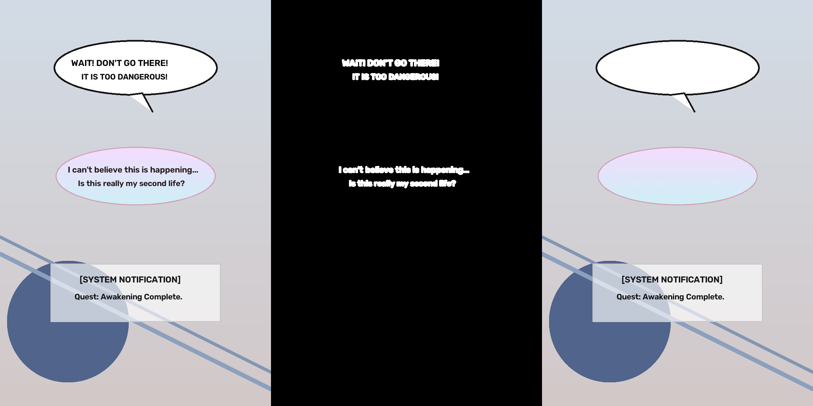

# 🎨 Manhwa & Webtoon Cleaner Agent (v3.1)

Agente automatizado com inteligência artificial para detecção e limpeza inteligente de balões e textos em inglês de **Manhwas, Webtoons e Mangás**, com exportação direta em arquivos `.PSD` multicamadas (Photoshop / Clip Studio Paint).



---

## ✨ Principais Diferenciais

- 🧠 **Detecção Neural com RT-DETR:** Utiliza modelo neural de detecção de objetos especializado em quadrinhos e webtoons (`ogkalu/comic-text-and-bubble-detector`).
- 🛡️ **Preservação Rígida de Bordas de Balão:** Algoritmo que filtra componentes conectados aos limites do balão, garantindo que o contorno e as linhas de traço nunca sejam apagados ou cortados.
- 🌈 **Suporte a Balões Escuros, Degradês e Semitransparentes:** Amostragem perimetral e distância euclidiana de cor em BGR. O agente **não pinta o balão de branco**; ele remove exclusivamente os traços das letras (*stroke-level inpainting*) e recompõe as cores e gradientes de fundo.
- 🔤 **Remoção de Textos Fora de Balões (*Free Text*):** Detecta falas soltas na arte e valida via EasyOCR para remover apenas inglês, preservando onomatopeias coreanas (SFX) e detalhes do desenho.
- 📜 **Suporte a Tiras Verticais Longas (Webtoons):** Fatiamento inteligente em blocos com sobreposição (*overlap*) de 300px, processando tiras verticais gigantescas de 14.000px a 15.000px sem travar a memória.
- 📂 **Exportação Direta em .PSD (2 Camadas):**
  - **`Editado`** *(Camada Superior / Visível)*: A página limpa e pronta para diagramação/typesetting.
  - **`Original`** *(Camada Inferior)*: A página original preservada como referência caso precise conferir o texto original.
  - Exportação ultra rápida utilizando compressão RAW (fração de segundo por página de 15k pixels).

---

## 🚀 Requisitos

- **Python 3.10, 3.11 ou 3.12**
- Conexão com a internet na primeira execução (para download automático dos modelos neurais)

---

## 📦 Instalação

### 1. Clonar o repositório

```bash
git clone https://github.com/markinhozz1/manhwa-cleaner-agent.git
cd manhwa-cleaner-agent
```

### 2. Criar e ativar um ambiente virtual (recomendado)

**No Windows (PowerShell):**
```powershell
python -m venv venv
.\venv\Scripts\Activate.ps1
```

**No Windows (CMD):**
```cmd
python -m venv venv
venv\Scripts\activate.bat
```

**No Linux / macOS:**
```bash
python3 -m venv venv
source venv/bin/activate
```

### 3. Instalar as dependências

```bash
pip install -r requirements.txt
```

> **Nota:** Na primeira vez em que o programa rodar, ele baixará automaticamente o modelo RT-DETR (~10MB do Hugging Face) e os modelos do EasyOCR (~200MB). Isso só ocorre uma única vez.

---

## 🛠️ Como Usar

### Opção 1: Limpar um Capítulo Inteiro (Pasta de Imagens)

Basta passar o caminho da pasta onde estão as páginas (`.jpg`, `.png`, `.webp`):

```bash
python cleaner_cli.py -i "C:\Caminho\Para\Seu\Capitulo\01"
```

Os arquivos limpos serão salvos automaticamente em formato `.psd` dentro de uma subpasta chamada `psd_limpos/`.

Se preferir definir outra pasta de saída:
```bash
python cleaner_cli.py -i "C:\Imagens\Cap01" -o "C:\Imagens\Cap01_Editados"
```

---

### Opção 2: Limpar uma Única Página

```bash
python cleaner_cli.py -i "pagina_01.jpg" -o "pagina_01_limpa.psd"
```

---

### Opção 3: Processamento em Lote de Vários Capítulos (`run_chapters.py`)

Para limpar múltiplos capítulos de uma vez mantendo o modelo carregado na memória:

```bash
python run_chapters.py "C:\Scans\Obra\101" "C:\Scans\Obra\102" "C:\Scans\Obra\103"
```

Ou você pode abrir o arquivo `run_chapters.py` no seu editor e preencher a lista de capítulos:

```python
capitulos = [
    r"C:\Scans\Obra\101",
    r"C:\Scans\Obra\102",
]
```
E depois rodar:
```bash
python run_chapters.py
```

---

## ⚙️ Parâmetros Avançados

Você pode personalizar o comportamento da limpeza através dos argumentos de linha de comando:

| Parâmetro | Padrão | Descrição |
|-----------|--------|-----------|
| `--dilate` | `2` | Dilatação da máscara do traço da letra. Se a fonte do manhwa tiver sombras fortes ou bordas grossas, aumente para `3`. |
| `--radius` | `3` | Raio de interpolação do inpainting (Telea). Valores entre `2` e `4` garantem restauração natural de degradês. |

Exemplo de uso com parâmetros customizados:
```bash
python cleaner_cli.py -i "capitulo_01" --dilate 3 --radius 3
```

---

## 💡 Dicas de Fluxo de Trabalho (Typesetting)

1. **Abra o arquivo `.psd` gerado** no Photoshop ou Clip Studio Paint.
2. Você verá duas camadas:
   - `Editado` (já limpa, sem as falas em inglês)
   - `Original` (imagem original abaixo)
3. Caso queira conferir o balão original para redigitar a tradução, basta ocultar momentaneamente a camada `Editado` clicando no ícone do olho na paleta de camadas.
4. Faça o typesetting das falas diretamente criando novas camadas de texto por cima da camada `Editado`.

---

## 🤝 Contribuições

Contribuições, correções de bugs e sugestões de novas funcionalidades são muito bem-vindas! Sinta-se à vontade para abrir uma *Issue* ou enviar um *Pull Request*.

---

## 📄 Licença

Distribuído sob a licença MIT. Consulte `LICENSE` para mais informações.
